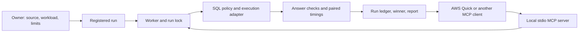

# Technical design

## Problem and intended outcome

An assistant can propose a plausible SQL optimization without knowing whether it helps on the user's data. The owner also needs confidence that faster execution did not silently alter a business metric. This project turns a proposal into a bounded, repeatable experiment with a retained record of the outcome.

The unit of optimization is a workload: a named set of reference queries, training parameter cases, held-out parameter cases, and an immutable source snapshot. Success means reducing the registered objective while preserving checked answers. The local objective is elapsed query time; the optional Athena adapter also supports bytes scanned.

## Components and ownership



`cli.py` registers sources and starts jobs. `server.py` exposes the existing runs to an MCP client. `engine.py` owns state transitions, comparison rules, and finalization. `sql.py` validates the supported SQL subset and fingerprints results. `local.py` executes DuckDB queries; `athena.py` implements the optional AWS path. `report.py` renders the recorded evidence. `flights.py` and `orders.py` are example workloads, not engine assumptions.

The owner selects the source and correctness contract. The assistant submits a hypothesis, a complete query mapping, and optional materialization SQL/settings. The assistant cannot change the registered source, limits, or evaluator through the MCP interface. Owner-level filesystem access can change them: this is interface isolation, not tamper-proof storage.

## Run lifecycle

Registration validates reference SQL, captures schema and row count, and hashes local data. A source is exposed under the relation name `data`. An optional candidate materialization is exposed as `cache` and belongs to that trial. Materializations are built from the original source, not from the previous trial's cache.

A baseline generates reference fingerprints on training cases and measures repeated query batches. A candidate must supply exactly the baseline query names. The worker builds its optional cache, checks answers, warms the incumbent, and alternates candidate/incumbent measurement order. Jobs run in a child process. A nonblocking Unix file lock permits one worker per run; the client polls status until the lock is released and report generation finishes.

The default run permits 12 records, **including the baseline**, three repetitions, 90 seconds per query, and 3,600 seconds of accumulated worker execution. The run budget is not an elapsed chat deadline: time between tool calls is not charged. Initialization, source inspection, and report rendering are not all strictly covered by the worker deadline. The 1 GB DuckDB setting is an engine memory budget, not an operating-system memory limit. Stop is cooperative: the current query ends or times out. No automatic stop-after-three rule exists in the engine; the Quick prompt supplies that policy.

Finalization seals the run before opening held-out cases. It recomputes reference answers, checks the selected candidate, and remeasures baseline and winner with alternating order. Failure still seals the run. A failed winner must not be adopted; create a new run to investigate. The tool cannot silently reopen final cases for tuning.

## Selection and correctness

Each measured sample totals every query over every training case. The score is the median of those totals. A candidate is kept only when:

```text
candidate_median < min(historical_best, paired_incumbent_median) × (1 − minimum_gain)
```

The default minimum gain is 3%. This guards against some timing drift but does not establish statistical significance. Warm-up and repeated comparisons do not eliminate cache, scheduling, hardware, or background-load effects.

Correctness uses output column names and exact result-multiset fingerprints, retaining duplicates and nulls while ignoring row ordering. Integers and exact decimals are canonicalized; floating-point differences are not rounded away. Aggregate queries returning more than 10,000 rows fail. Fixed-point amounts are preferable for money. Ordered-result contracts and approximate numeric tolerances are out of scope.

Held-out cases exercise new parameters on the **same source snapshot**. They do not establish correctness on future data or arbitrary SQL inputs. A candidate can still overfit a finite suite. The owner should include nulls, empty results, boundaries, cancellation rules, and other domain cases. The tests demonstrate both rejection of a wrong answer and sealing after a held-out failure.

## MCP tool contract

| Tool | Input | Effect / output |
|---|---|---|
| `list_research_runs` | None | Registered IDs, names, sealed status |
| `research_status` | `run_id` | Schema, training workload, limits, history, job state; held-out parameters omitted |
| `start_baseline` | `run_id` | Starts baseline asynchronously |
| `submit_experiment` | `run_id`, `candidate_json` string | Starts a validated candidate experiment asynchronously |
| `get_candidate` | `run_id`, integer `trial` | Previously submitted SQL and materialization |
| `stop_research` | `run_id` | Requests cooperative stop |
| `finalize_research` | `run_id` | Seals, verifies, and measures held-out workload asynchronously |
| `get_progress_chart` | `run_id` | Recorded PNG chart after a baseline exists |

The client waits for `research_status.job.status` to leave `running` before the next experiment, and handles `error` explicitly. Mutation tools may use the owner's preauthorized Athena budget. Their permission treatment belongs to the client. Tool annotations are hints, not an authorization system.

## Trust boundary and data exposure

Candidates are restricted SELECT SQL with controlled materialization options, not arbitrary Python or shell. The local adapter restricts external file reads to registered source/cache paths and disables automatic extension installation/loading and general external access. SQL validation rejects unsupported functions and relations. These controls reduce the prototype's surface area; they are not an audited sandbox for hostile clients.

Quick receives schema, paths, training filters, submitted SQL, hypotheses, measurements, errors, and charts. Raw result rows are not deliberately returned by these tools, but metadata, literal filters, error messages, and aggregates can still be sensitive. Use an approved assistant and account for the chosen data. The server has no remote transport, shared-user authentication, or tenant isolation. Remote enterprise hosting would require those controls, a separate evaluator identity, storage isolation, and a review of the SQL execution boundary.

## Costs and adoption

The query-time objective excludes cache construction and assistant latency. Reports show the winning cache's build time and size separately. The reported break-even is `ceil(build_seconds / (baseline_batch_seconds − winner_batch_seconds))` when savings are positive. It does not repay all research cost or model cost. A batch means all final cases and queries, not necessarily one user interaction.

A winner is a proposal for owner review. Refresh scheduling, incremental materialized views, schema evolution, production deployment, dashboard updates, rollback, and monitoring are not implemented. Existing production tables should be exposed as immutable snapshots; each changed source requires a new run.

## Extension points

For another domain, supply workload JSON and a CSV/Parquet file; no engine change is needed. For a new engine, implement the execution/materialization boundary and adapt source registration and objective accounting, with tests for result semantics, timeouts, isolation, and cleanup. Multi-source joins require an owner-managed input view or a deliberate adapter extension; the current run registers one source.
